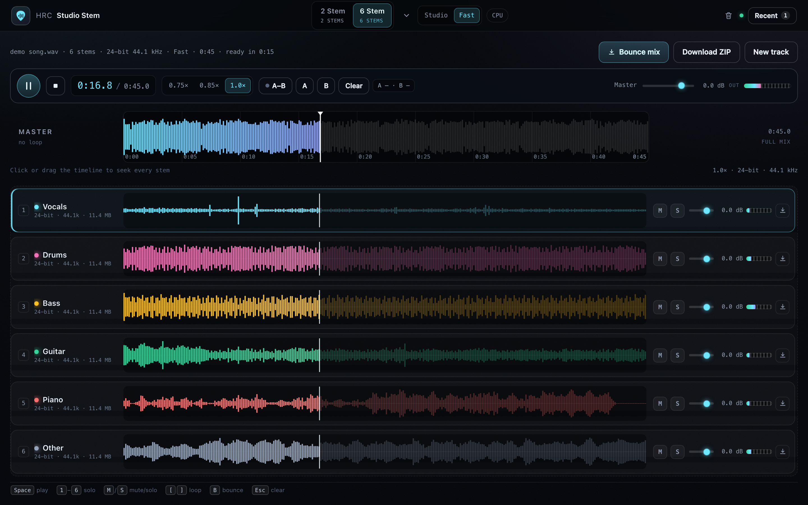

<div align="center">


### *Split any track into lossless 24-bit stems, then practise in a multi-track studio.*

**Built by the HRC Jamming Crew · <https://github.com/vollstek-ops/hrc-studio-stem>**

[](https://github.com/vollstek-ops/hrc-studio-stem/stargazers)
[](https://github.com/vollstek-ops/hrc-studio-stem/forks)
[](https://github.com/vollstek-ops/hrc-studio-stem/blob/master/LICENSE)
[](https://www.python.org/)
[](#5--why-the-output-is-really-24-bit)

[Requirements](#1--requirements) ·
[Setup](#2--setup) ·
[Run the app](#3--run-the-web-app) ·
[Practice studio](#3--run-the-web-app) ·
[CLI](#4--run-the-cli) ·
[24-bit](#5--why-the-output-is-really-24-bit) ·
[API](#6--http-api) ·
[Config](#7--configuration) ·
[Troubleshooting](#9--troubleshooting)



</div>

Split any track into **lossless 24-bit WAV** stems, locally, with a desktop-style web
UI and a matching CLI. Built on [`audio-separator`](https://github.com/nomadkaraoke/python-audio-separator)
(BS-RoFormer + HTDemucs) and FastAPI.

---

## Who it's for

| End user | What they do with it |
| --- | --- |
| **Guitarists, bassists, drummers, pianists** | mute their own instrument and play along with the rest of the band, or solo a part to learn it note-for-note |
| **Vocalists & singing students** | sing over the instrumental, or isolate a vocal line to study phrasing and harmony |
| **Music teachers & students** | slow a passage to 0.75×/0.85×, loop the tricky eight bars with A–B loop, and bounce the exercise |
| **Producers, remixers & DJs** | pull clean 24-bit stems for sampling, mashups and sets — acapellas, drum buses, bass lines |
| **Karaoke & cover creators** | turn any track into a backing track in one click, straight from a YouTube link |
| **Audio engineers** | verify a separation against the original (stems sum back to the mix), then export per-stem WAVs or a custom bounce |

**The core use case:** drop a song (or paste a link), get lossless stems in seconds, then
rehearse against them in a studio where every lane can be muted, soloed, slowed and
looped — all local, nothing leaves the machine.

| Mode | Model | Stems |
| --- | --- | --- |
| `2stem` | `model_bs_roformer_ep_317_sdr_12.9755.ckpt` (BS-RoFormer, SDR 12.98) | Vocals, Instrumental |
| `6stem` | `htdemucs_6s.yaml` (Hybrid Transformer Demucs, 6-source) | Vocals, Drums, Bass, Guitar, Piano, Other |

Everything runs on this machine. No uploads to third parties, no accounts, no watermarks.

---

## 1 · Requirements

| | |
| --- | --- |
| Python | 3.10 – 3.13 (`python3 --version`) |
| FFmpeg | required for decoding MP3/M4A/flac and for 24-bit WAV handling |
| RAM | ~3 GB free for `2stem`, ~4 GB for `6stem` |
| Disk | ~1.5 GB for the model cache (downloaded once) |
| GPU | optional: CUDA or Apple Silicon MPS is used automatically when present |

Install FFmpeg if you do not have it:

```bash
# macOS
brew install ffmpeg

# Debian / Ubuntu
sudo apt update && sudo apt install -y ffmpeg

# Windows (PowerShell, with winget)
winget install Gyan.FFmpeg
```

Check it is on PATH: `ffmpeg -version`

---

## 2 · Setup

```bash
cd stem

# 1. virtual environment
python3 -m venv .venv
source .venv/bin/activate          # Windows: .venv\Scripts\activate

# 2. dependencies (pulls PyTorch + audio-separator)
pip install --upgrade pip
pip install -r requirements.txt
```

**GPU note** — for an NVIDIA card, install the CUDA build of PyTorch and onnxruntime first,
then the requirements:

```bash
pip install torch torchaudio --index-url https://download.pytorch.org/whl/cu124
pip install "audio-separator[gpu]"
pip install -r requirements.txt
```

Apple Silicon needs nothing extra; MPS is detected and used automatically.

---

## 3 · Run the web app

```bash
python app.py
```

Open **<http://127.0.0.1:8000>**.

1. Pick a mode (`2 Stem` or `6 Stem`) and a quality preset in the header.
2. Drag a track onto the drop zone — or paste a YouTube link on the **YouTube link** tab
   (`yt-dlp` does the fetching; public links up to 20 minutes).
3. Watch the loader: a progress ring with the live pipeline — *Fetching → Decoding →
   Loading model → Separating → Writing → Finalising* — plus an ETA.
4. The stems open in the practice studio — a master transport over one shared timeline:

| Control | What it does |
| --- | --- |
| Play / pause, stop | `Space` plays or pauses every stem from one clock, `Home` rewinds |
| Speed `0.75× / 0.85× / 1.0×` | changes playback rate on all stems, pitch preserved |
| Timeline | click or drag anywhere to seek every stem together |
| `A–B loop` | set A and B at the playhead (`[`, `]`), toggle with `L`, `Esc` clears |
| `M` / `S` + fader | mute, solo and level per stem, with a live meter on each lane |
| `1`–`6` | solo that stem instantly (press again to clear) |
| **Bounce mix** (`B`) | renders exactly what you hear — mute, solo and faders — to one 24-bit WAV |
| **Download all (ZIP)** | one archive with every 24-bit WAV plus a `README.txt` manifest |

The master lane and the stem lanes share the same grid, so a playhead, a loop boundary or
a click means the same instant on every row.

A bounce is a true summing bus (`amix` with `normalize=0`): with the faders at unity it
reconstructs the original mix, one muted stem is `-∞`, and a fader at 50 % is exactly
`-6.0 dB`. Bounces live in `work/<job>/bounces/` and the newest six are kept.

### Quality presets

| Preset | What changes | Measured on Apple Silicon (MPS) |
| --- | --- | --- |
| **Studio** | full RoFormer overlap (8), single-chunk batches, Demucs `shifts=2` | reference |
| **Fast** | `batch_size=4`, RoFormer overlap 4, Demucs `shifts=1` / `overlap=0.1` | **1.76× faster** (2 stem) · **2.73× faster** (6 stem) |

Fast trades a little separation detail for rehearsal speed; the presets only touch the
chunking knobs of the architecture a mode actually uses (`mdx_params` / `vr_params` are
passed through for the MDX and VR families). Inference runs on **Apple Silicon MPS** when
`torch.backends.mps.is_available()` — the app verifies the device with a real tensor op at
startup and shows it in the header.

The **Clear caches** button in the header (broom icon) frees model memory, deletes
rebuildable ZIP archives and temp files, and prunes sessions past their TTL — stems,
bounces and running jobs are never touched.

Finished results are addressable: `http://127.0.0.1:8000/?job=<job id>` reopens that
session's stems (the URL updates itself after every run), so a reload never loses your work.

Host/port are configurable without editing code:

```bash
STEM_HOST=0.0.0.0 STEM_PORT=9000 python app.py     # expose on the LAN
STEM_RELOAD=1 python app.py                        # auto-reload while developing
```

Production-ish run (no reload, several workers is **not** recommended — models are cached per process):

```bash
.venv/bin/uvicorn app:app --host 127.0.0.1 --port 8000
```

> First run of each mode downloads its checkpoint into `./models` and can take a few
> minutes. Later runs start immediately.

---

## 4 · Run the CLI

```bash
# 2 stem: Vocals + Instrumental (default mode)
python cli.py track.mp3

# 6 stem: Vocals / Drums / Bass / Guitar / Piano / Other
python cli.py track.flac --mode 6stem

# batch, into a chosen folder, keeping only vocals
python cli.py album/*.wav --mode 2stem --out ./stems --single-stem Vocals

# machine-readable manifest
python cli.py track.wav --mode 6stem --json

# look at the modes help
python cli.py --list-modes
```

Output layout (`./separated/<track name>/`):

```
separated/My Song/
├── vocals.wav
└── instrumental.wav          # 6stem mode produces drums/bass/guitar/piano/other too
```

Underneath, each mode is the corresponding `audio-separator` call, e.g.:

```bash
audio-separator "My Song.wav" --model_filename model_bs_roformer_ep_317_sdr_12.9755.ckpt \
    --output_format WAV --output_dir ./stems
audio-separator "My Song.wav" --model_filename htdemucs_6s.yaml \
    --output_format WAV --output_dir ./stems
```

---

## 5 · Why the output is really 24-bit

`audio-separator` chooses the WAV subtype of its output from the **input file's** subtype
(`PCM_16` in → 16-bit stems out). HRC Studio Stem therefore decodes every upload to
`pcm_s24le` at 44.1 kHz first, hands that to the model, then re-checks each written stem
with `soundfile` and re-writes it as `PCM_24` if anything else slipped through.

Result: every stem is **24-bit PCM WAV**, no MP3/AAC step anywhere in the chain, and no
peak normalisation by default (mix levels are preserved; enable normalisation only if you
want it — see `normalization_threshold` in `stemkit/separator.py`).

---

## 6 · HTTP API

| Method | Path | Purpose |
| --- | --- | --- |
| `GET` | `/api/health` | engine version, ffmpeg availability, upload limit |
| `GET` | `/api/modes` | mode metadata (stems, model, bit depth) |
| `POST` | `/api/jobs` | multipart: `file`, `mode` → job object |
| `GET` | `/api/jobs` | recent jobs |
| `GET` | `/api/jobs/{id}` | status, stage, progress, stem list |
| `POST` | `/api/jobs/{id}/cancel` | stop after the current chunk |
| `DELETE` | `/api/jobs/{id}` | drop the job and its audio |
| `GET` | `/api/jobs/{id}/audio/{slug}` | WAV stream with HTTP range support |
| `GET` | `/api/jobs/{id}/download/{slug}` | `Content-Disposition: attachment` |
| `GET` | `/api/jobs/{id}/download-all` | ZIP of every 24-bit WAV stem + `README.txt` manifest (cached per job) |
| `POST` | `/api/jobs/{id}/mixdown` | body `{"stems":[{"slug","gain"}],"name"}` → 24-bit WAV bounce |
| `GET` | `/api/jobs/{id}/mixdown/{file}` | stream or (`?download=1`) download a bounce |

```bash
curl -F "file=@track.mp3" -F "mode=2stem" http://127.0.0.1:8000/api/jobs
curl http://127.0.0.1:8000/api/jobs/<id>
curl -OJ http://127.0.0.1:8000/api/jobs/<id>/download/vocals
curl -OJ http://127.0.0.1:8000/api/jobs/<id>/download-all
curl -X POST http://127.0.0.1:8000/api/jobs/<id>/mixdown \
     -H 'Content-Type: application/json' \
     -d '{"stems":[{"slug":"vocals","gain":1},{"slug":"instrumental","gain":0}],"name":"vocals only"}'
```

Every job snapshot also carries `pipeline` (the five stages with `state` and
seconds spent) and `eta_seconds`, which is what the progress panel and the studio
are built from.

---

## 7 · Configuration

| Variable | Default | Meaning |
| --- | --- | --- |
| `STEM_HOST` | `127.0.0.1` | bind address for `python app.py` |
| `STEM_PORT` | `8000` | port |
| `STEM_RELOAD` | off | `1` enables auto-reload |
| `STEM_MODEL_DIR` | `./models` | model cache |
| `STEM_WORK_DIR` | `./work` | per-job inputs/outputs |
| `STEM_MAX_UPLOAD_MB` | `500` | upload rejection threshold |
| `STEM_JOB_TTL_HOURS` | `12` | finished jobs (and their audio) are swept after this |
| `STEM_LOG_LEVEL` | `INFO` | app log level |

---

## 8 · Project layout

```
stem/
├── app.py                  FastAPI app: pages, JSON API, ranged audio, downloads
├── cli.py                  `--mode 2stem|6stem` command line front-end
├── requirements.txt
├── templates/index.html    single-page UI
├── static/app.css          studio dark theme
├── static/app.js           drag-drop, polling, pipeline, WebAudio studio mixer
├── static/favicon.svg
├── stemkit/
│   ├── config.py           modes → model mapping, paths, limits
│   ├── audio.py            ffprobe/ffmpeg probing, 24-bit decode/verify, peaks
│   ├── progress.py         real per-chunk progress out of audio-separator's tqdm
│   ├── separator.py        one file in → stems + manifest out
│   └── jobs.py             single-worker queue, state, cancel, janitor
├── models/                 downloaded checkpoints (git-ignored)
└── work/                   per-job scratch space (git-ignored)
```

---

## 9 · Troubleshooting

| Symptom | Fix |
| --- | --- |
| `ffmpeg was not found on PATH` | install FFmpeg (section 1) and restart the server |
| First job hangs at *Loading model* | it is downloading a ~1 GB checkpoint; watch the server log |
| `RuntimeError: ... out of memory` | close other apps, use `2stem`, or try a shorter file |
| Very slow separation | expected on CPU: roughly 1–3× the track length; GPU/MPS is much faster |
| `413` on upload | raise `STEM_MAX_UPLOAD_MB` |
| Progress bar sits at a stage | the current chunk is still computing; the bar creeps but never lies about completion |
| Browser cannot seek in the preview | only range-capable servers can seek — served by `/api/jobs/{id}/audio/{slug}` |
| Results vanished after a restart | job metadata is reloaded from `work/`, but audio older than `STEM_JOB_TTL_HOURS` is swept |

---

## 10 · Credits & licence

- Separation models and inference: [`audio-separator`](https://github.com/nomadkaraoke/python-audio-separator) (MIT),
  using UVR models by @Anjok07 and BS-RoFormer by @lucidrains.
- Web app, CLI and 24-bit pipeline in this repository: MIT.
- Only separate audio you have the rights to use.
